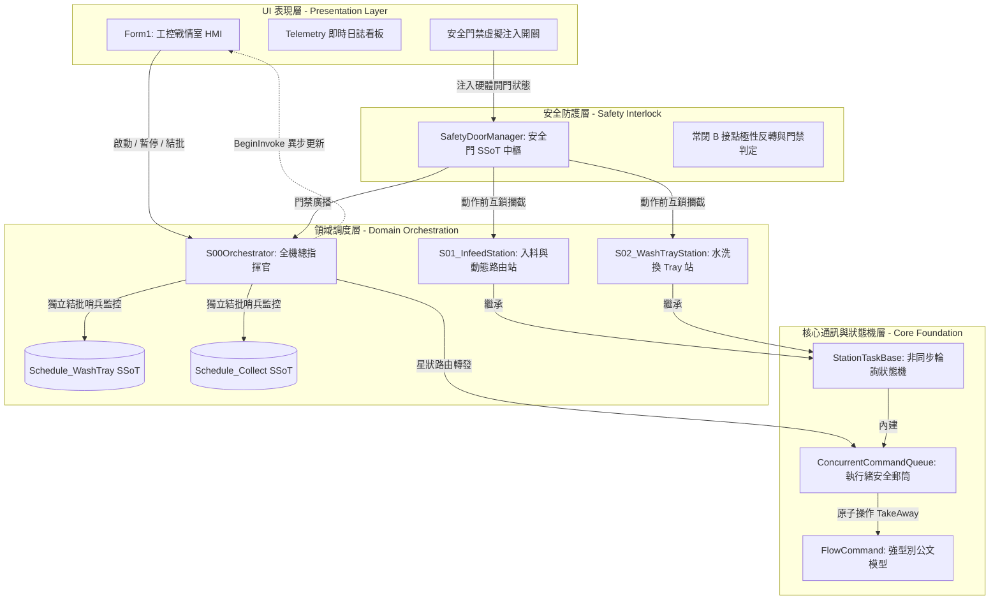
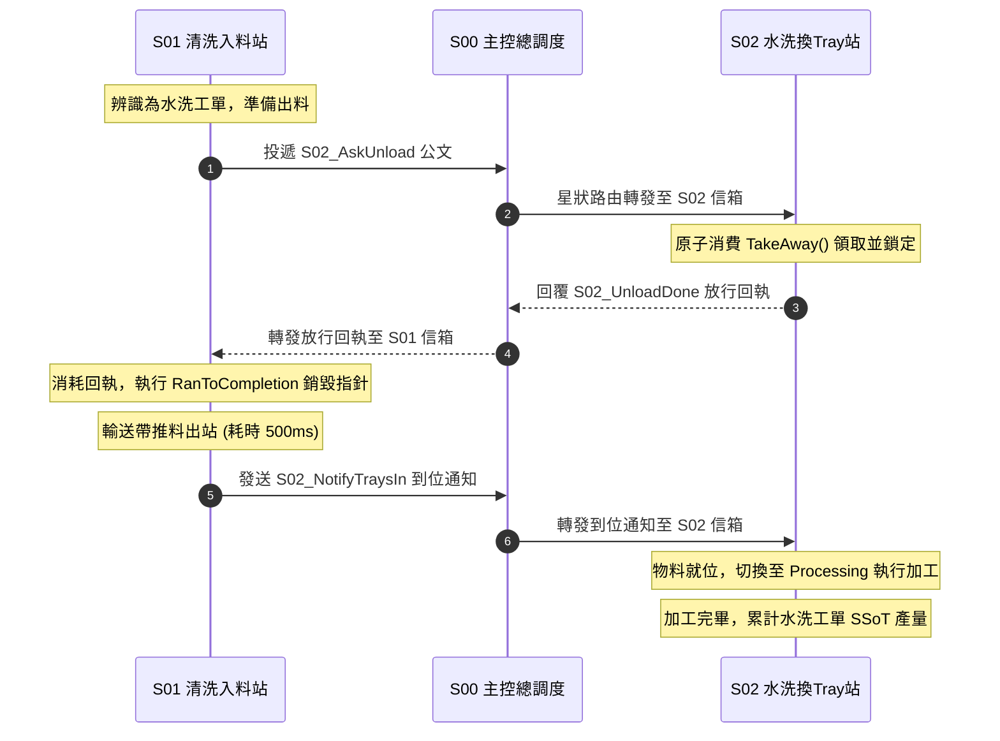

# Industrial Multi-Zone Flow Orchestrator
> **高可靠度工業控制分散式狀態機與雙分區生產調度引擎**  
> 基於 C# / .NET Framework 4.8 打造，專注於解決半導體與連續製程產線之「跨站交握死鎖」、「雙工單分區衝突」與「常閉 B 接點極性反轉」等核心架構挑戰。

---

## 📌 核心能力與技術棧 (Tech Stack & Capabilities)

* **架構風格**：領域分層架構 (Clean Architecture)、星狀公文轉發拓撲 (Star Routing Topology)、單一真理來源 (SSoT)。
* **多執行緒與併發**：非同步狀態機 (FSM WorkerLoop)、執行緒安全公文信箱 (`ConcurrentCommandQueue<T>`)、原子消費 (`TakeAway`)、過橋抽板指標銷毀 (`RanToCompletion`)。
* **工業電控與防禦性設計**：常閉 NC (B 接點) 硬體極性校驗、空間互鎖門禁 (Pre-check Interlock)、分區生產隔離 (Dual-Zone Isolation)。
* **UI 與軟體品質**：深色主題 HMI 戰情看板、跨執行緒非同步派發 (`BeginInvoke`) 杜絕假死、無外部商業 DLL 依賴 (可直接 F5 原生執行)。

---

## 🏛️ 系統分層架構圖 (System Architecture)

系統嚴格遵循關注點分離 (Separation of Concerns)，將「UI 表現」、「總控調度」、「安全防護」與「底層公文動脈」解耦：



## 🔄 跨站星狀公文交握時序 (Handshake Sequence)

子站點之間嚴禁互相持有實體物件或直接呼叫函數。所有跨站需求皆透過 `FlowCommand<T>` 送交 S00 總控路由轉發，落實非阻塞輪詢與過橋抽板閉環：



## 🛠️ 三大工業級工程挑戰與實作解析 (Engineering Highlights)

### 1. 跨站並發安全與「過橋抽板」防幽靈重入機制
* **痛點**：工控狀態機在多執行緒高速輪詢（Polling）下，若使用傳統 `List<T>` 查與刪，極易發生 Race Condition 或集合修改例外；若公文完工後未及時斷開引用，下一 Scan Cycle 會引發「幽靈指令重複執行」導致撞機。
* **解法**：
  1. 實作 `ConcurrentCommandQueue<T>` 的原子消費擴充 `TakeAway()`，在單一 `lock` 臨界區內同時完成條件比對與拔取。
  2. 導入 `FlowCommand<T>.RanToCompletion(ref cmd)`，於任務完工瞬間將指令指標安全歸零（`null`），徹底隔絕時序污染。

```csharp
// 摘自 S01_InfeedStation.cs: 原子消費與過橋抽板
var cmd = Mailbox.TakeAway(x => x.Command == StationCmd.S01_AskLoadReady);
if (cmd != null || AutoFeedEnabled)
{
    // 【關鍵防護】過橋抽板：標記完工並斷開參照，防止重複觸發
    FlowCommand<StationCmd>.RanToCompletion(ref cmd); 
    _workingMode = EmS01Working.Load;
    DispatchLog("S01 收到進料命令，啟動入料輸送帶。");
}
```

### 2. 雙工單分區生產隔離與非阻塞結批哨兵
* **痛點**：傳統單機排程將全線設備綁定於單一帳本，導致「水洗換 Tray 區」與「收盤區」無法並行運作；單區完工時若直接呼叫 UI 彈窗，會凍結背景調度執行緒引發全線死鎖。
* **解法**：
  1. 在 S00 導入 `TryHandleZoneLotFinish` 分區巡檢哨兵，將水洗區與收盤區工單解耦為獨立的 SSoT 領域模型。
  2. 當單區達標時，只銷毀該區帳本並透過 `BeginInvoke` 進行非同步彈窗，另一分區不受任何牽制持續生產。

```csharp
// 摘自 S00Orchestrator.cs: 分區獨立結批哨兵
private bool TryHandleZoneLotFinish(EmProductionZone zone)
{
    var schedule = GetZoneSchedule(zone);
    if (schedule == null || !schedule.IsFinish) return false;
    if (!IsZoneClearForLotEnd(zone)) return false;

    // 觸發分區完工事件 (UI 層以 BeginInvoke 彈窗，絕不阻塞背景 Task)
    ZoneLotFinished?.Invoke(zone, schedule);

    // 生命週期隔離：只清空該分區帳本，絕不誤殺另一區
    ClearZoneSchedule(zone);
    return true;
}
```

### 3. 常閉 B 接點 (NC Contact) 極性校驗與防撞安全互鎖
* **痛點**：工業級安全門感測器物理上採用「常閉 B 接點（NC Contact）」設計（導通=安全，斷線/開門=危險）。若軟體層未封裝極性反轉，容易因直覺誤用布林值而造成重大工安意外或機構撞毀。
* **解法**：
  1. 於 `SafetyDoorManager` 統一實作極性反轉映射，對外僅暴露語意明確的 `IsZoneSafe(zone)` 查詢介面。
  2. 單站動作前置入 Pre-check Interlock Guard 門禁，並內建模擬注入機制供現場演示。

```csharp
// 摘自 SafetyDoorManager.cs: B 接點極性校驗
public void UpdateHardwareSignal(SafetyDoorZone zone, bool rawBContactDi)
{
    // B 接點極性反轉：感測器導通 (true) 代表安全關閉；斷開 (false) 代表危險開門
    bool isOpened = !rawBContactDi;
    SetDoorStateInternal(zone, isOpened);
}
```

## 🚀 快速上手與現場操作指引 (Quick Start)

專案已內建完整的虛擬空跑環境（Virtual Mocking），無需連接任何實體 PLC、運動控制卡或外部商業 DLL 即可直接編譯運行：

1. **環境需求**：Visual Studio 2019 / 2022，具備 `.NET Framework 4.8` 開發套件。
2. **建置方案**：
   * 使用 Visual Studio 開啟 `MultiZoneFlowOrchestrator.sln`。
   * 按下 `Ctrl + Shift + B` 執行建置，確認輸出為 0 個失敗。
3. **啟動除錯 (F5)**：
   * 點擊 **[啟動 Run]**，勾選 **[S01 自動入料模擬]**，即可觀察站點間高速公文交握與產量進度條推展。
   * 點擊 **[手動結批]** 或等待工單達標，驗證「單區獨立彈窗、另一區不中斷生產」之隔離能力。
   * 點擊 **[前維護門]** 或 **[水洗安全門]** 開關，驗證安全門禁即時中斷機構動作之 Interlock 防護機制。


